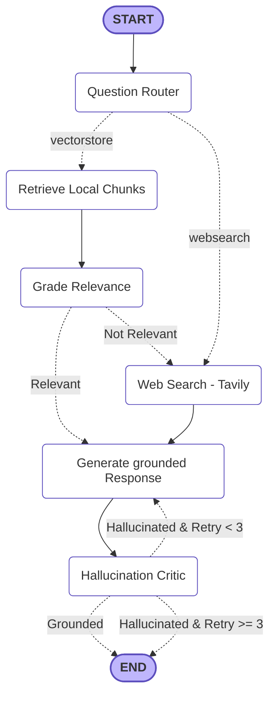

# Self-Correcting Multi-Agent RAG Pipeline using LangGraph

An enterprise-grade, production-ready Self-Correcting Retrieval-Augmented Generation (RAG) system utilizing **LangGraph** (StateGraph) to orchestrate an intelligent multi-agent workflow. 

The system features dynamic query routing, concurrent context relevance grading, hallucination detection (Self-RAG), automated fallback to web search via Tavily, and structured agent outputs with source citations.

---

## 📖 Table of Contents
1. [System Architecture](#-system-architecture)
2. [Key Features](#-key-features)
3. [Folder Structure](#-folder-structure)
4. [Tech Stack](#-tech-stack)
5. [Installation & Setup](#-installation--setup)
6. [Ingesting Documents](#-ingesting-documents)
7. [Running the Application](#-running-the-application)
8. [API Endpoints & Swagger](#-api-endpoints--swagger)
9. [Sample JSON Outputs](#-sample-json-outputs)
10. [Automated Testing](#-automated-testing)
11. [Future Improvements](#-future-improvements)
12. [License](#-license)

---

## 🏗 System Architecture

The pipeline is modeled as a StateGraph with conditional transition decisions based on LLM critique evaluation scores:



For detailed sequence flows and database diagrams, read [architecture.md](docs/architecture.md).

---

## ✨ Key Features

*   **Intelligent Routing**: Determines if a query can be answered using internal database records (`vectorstore`) or requires search engine access (`websearch`).
*   **Concurrent relevance Grading**: Evaluates each retrieved document chunk's relevance concurrently using a thread pool. Irrelevant documents are discarded to prevent dilution.
*   **Web Search Fallback**: Automatically falls back to Tavily Web Search if local context is absent or fails relevance verification.
*   **Self-Correction Loop (Self-RAG)**: An LLM-based factual evaluator checks response assertions against source documents. If hallucinations are detected, the response is regenerated (up to 3 retries).
*   **Cached Vector DB Connections**: Singleton caching of Chroma DB connections prevents resource leaks and improves speed.
*   **Observability**: Detailed telemetry capturing execution duration per node, path logs, and rich-styled terminal indicators using `loguru` and `rich`.
*   **FastAPI endpoints**: Exposes ready endpoints for search query, document ingestion, monitoring, and live metrics.

---

## 📁 Folder Structure

```
.
├── app/
│   ├── config.py             # Pydantic Settings & validation
│   ├── main.py               # FastAPI entry point & routers
│   ├── graph/
│   │   ├── edges.py          # LangGraph routing decision functions
│   │   ├── graph.py          # StateGraph configuration and compile
│   │   ├── prompts.py        # Factual grounding & grading system prompts
│   │   ├── router.py         # Router chain structured output setup
│   │   ├── state.py          # TypedDict AgentState schema
│   │   └── nodes/
│   │       ├── generate.py           # grounded text generation node
│   │       ├── grade_documents.py    # Document relevance filter node
│   │       ├── hallucination.py      # Hallucination evaluator node
│   │       ├── retrieve.py           # Chroma similarity retriever node
│   │       ├── router.py             # Router chain invoke node
│   │       └── web_search.py         # Tavily web search node
│   ├── schemas/
│   │   └── models.py         # API Request/Response models
│   └── vectorstore/
│       ├── chroma.py         # Vectorstore & retriever setup
│       ├── embeddings.py     # OpenAI/Ollama embeddings resolver
│       ├── ingestion.py      # Ingestion pipeline manager
│       └── loader.py         # PDF, Markdown, text, and JSON loaders
├── docs/
│   └── architecture.md       # Visual sequence flows
├── scripts/
│   ├── ingest_data.py            # Local document ingestion cli script
│   ├── visualize_graph.py        # Mermaid diagram printer
│   └── visualize_workflow_v1.py  # V1 workflow diagram printer
├── tests/                    # Pytest suite
└── docker-compose.yml
```

---

## 🛠 Tech Stack

*   **Runtime**: Python 3.12
*   **Orchestrator**: LangGraph (v0.1+) & LangChain Core
*   **Models**: OpenAI (GPT-4o) / Google Gemini (1.5 Flash / Pro) / Groq (Llama 3.3 70B) / Ollama
*   **Vector DB**: ChromaDB (`langchain-chroma`)
*   **Search Engine**: Tavily API
*   **Web Server**: FastAPI & Uvicorn
*   **Observability**: Loguru & Rich
*   **Testing**: Pytest, Pytest-Asyncio
*   **Quality**: Black, Ruff, Mypy

---

## 🚀 Installation & Setup

### 1. Clone & Navigate
```bash
git clone https://github.com/your-username/self-correcting-multi-agent-rag.git
cd self-correcting-multi-agent-rag
```

### 2. Configure Environment Variables
Create a local `.env` configuration matching `.env.example`:
```bash
cp .env.example .env
```
Fill in your active keys:
```env
LLM_PROVIDER=openai
OPENAI_API_KEY=sk-...
TAVILY_API_KEY=tvly-...
```

### 3. Local Installation
```bash
# Using Makefile
make install
```
*Alternatively:* `pip install -r requirements.txt`

---

## 📥 Ingesting Documents

You can load your own `.txt`, `.md`, `.pdf`, or `.json` files into the Chroma database.

Place files in `sample_documents/` and run:
```bash
# Using Makefile
make ingest
```
*Or execute directly:*
```bash
python scripts/ingest_data.py --path sample_documents --chunk-size 800 --chunk-overlap 150
```

---

## 🏃 Running the Application

### Method 1: Local Development
Start the FastAPI server locally in reload mode:
```bash
make run
```
*Or execute directly:*
```bash
uvicorn app.main:app --reload --host 0.0.0.0 --port 8000
```

### Method 2: Docker Compose (Production Setup)
Run API inside isolated containers with mounted persistent volumes:
```bash
# Start container
make docker-up

# Stop container
make docker-down
```
*Or execute directly:* `docker-compose up --build -d`

---

## 🔌 API Endpoints & Swagger

Access the interactive API documentation at:
*   **Swagger UI**: [http://localhost:8000/docs](http://localhost:8000/docs)
*   **Redoc**: [http://localhost:8000/redoc](http://localhost:8000/redoc)

### Sample API Requests

#### 1. Ingestion Request
```bash
curl -X POST "http://localhost:8000/ingest" \
     -H "Content-Type: application/json" \
     -d '{"path": "./sample_documents/project_helios.md"}'
```

#### 2. Querying Vectorstore
```bash
curl -X POST "http://localhost:8000/query" \
     -H "Content-Type: application/json" \
     -d '{"question": "Who is the lead system architect for Project Helios?"}'
```

---

## 📊 Sample JSON Outputs

Here is a sample response payload returned by `/query` for a successful local retrieval:

```json
{
  "question": "Who is the lead system architect for Project Helios?",
  "answer": "The lead system architect for Project Helios is Sarah Vance [1].",
  "sources": ["project_helios.md"],
  "steps": [
    "router_node",
    "retrieve_node",
    "grade_documents_node",
    "generate_node",
    "hallucination_grader_node"
  ],
  "execution_time": {
    "retrieve": 0.045,
    "grade_documents": 0.122,
    "generate": 0.380,
    "hallucination_grader": 0.290,
    "total_pipeline": 0.837
  },
  "search_required": false,
  "retry_count": 0,
  "errors": []
}
```

---

## 🧪 Automated Testing

We enforce code quality using `ruff`, `black`, and `mypy`.

To execute the test suite (23 unit and integration tests passing):
```bash
# Format
make format

# Lint
make lint

# Test
make test
```
*Or run:* `pytest --tb=short -v`

---

## 🔮 Future Improvements

1.  **Hybrid Dense-Sparse Retrieval**: Integrate BM25 alongside semantic Chroma embeddings for better keyword matching.
2.  **Cross-Encoder Re-ranking**: Add a re-ranking model (e.g. FlashRank) to sort retrieved chunks before grading.
3.  **Local LLM execution**: Enhance support for offline Ollama/vLLM serving for compliance audits.

---

## 📄 License

Distributed under the MIT License. See [LICENSE](LICENSE) for details.
