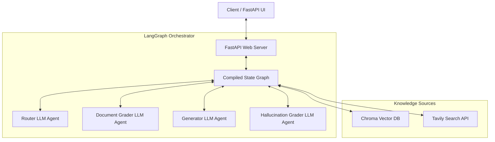
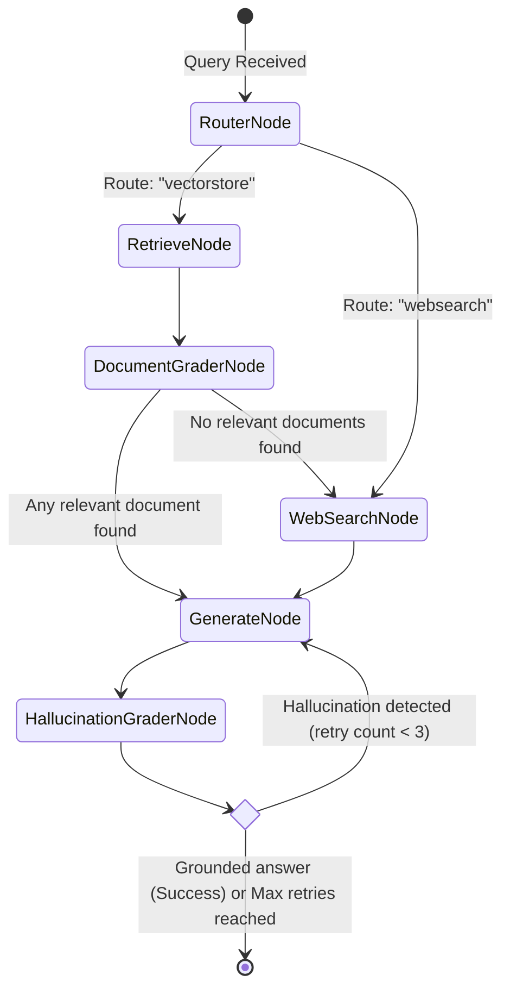
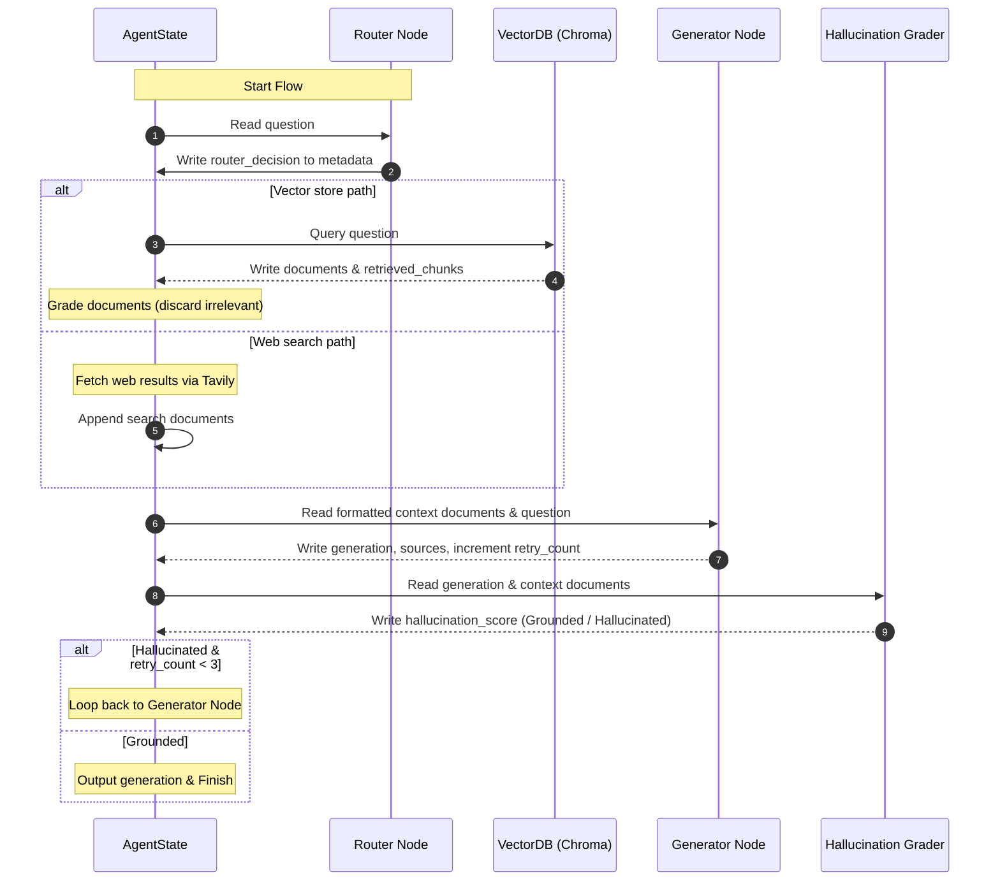
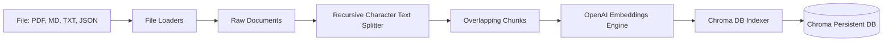

# Architecture Overview - Self-Correcting Multi-Agent RAG

This document illustrates the technical design, data flows, state machine nodes, and ingestion mechanics of the Self-Correcting RAG system built using LangGraph.

---

## 1. Overall System Architecture



---

## 2. LangGraph State Machine Workflow

The graph begins at `START` and executes agent states based on the routing parameters and grades.



---

## 3. Data Flow and State Modifications

Each node receives the current `AgentState`, processes data, and returns a dictionary updating specific state attributes.



---

## 4. RAG Ingestion Pipeline

The ingestion pipeline handles preprocessing and text partitioning to store information in the Chroma persistent store.



---

## 5. Folder Structure Tree

```
self-correcting-multi-agent-rag/
├── README.md
├── requirements.txt
├── pyproject.toml
├── Dockerfile
├── docker-compose.yml
├── .env.example
├── .gitignore
├── LICENSE
├── Makefile
├── .github/
│   └── workflows/
│       └── python.yml
├── docs/
│   └── architecture.md
├── app/
│   ├── __init__.py
│   ├── main.py
│   ├── config.py
│   ├── graph/
│   │   ├── __init__.py
│   │   ├── state.py
│   │   ├── graph.py
│   │   ├── router.py
│   │   ├── edges.py
│   │   ├── prompts.py
│   │   └── nodes/
│   │       ├── __init__.py
│   │       ├── router.py
│   │       ├── retrieve.py
│   │       ├── grade_documents.py
│   │       ├── web_search.py
│   │       ├── generate.py
│   │       └── hallucination.py
│   ├── vectorstore/
│   │   ├── __init__.py
│   │   ├── chroma.py
│   │   ├── loader.py
│   │   ├── embeddings.py
│   │   └── ingestion.py
│   ├── llm/
│   │   ├── __init__.py
│   │   ├── provider.py
│   │   ├── openai.py
│   │   └── groq.py
│   ├── schemas/
│   │   ├── __init__.py
│   │   └── models.py
│   └── utils/
│       ├── __init__.py
│       ├── logger.py
│       ├── helpers.py
│       └── timing.py
├── tests/
└── scripts/
```
